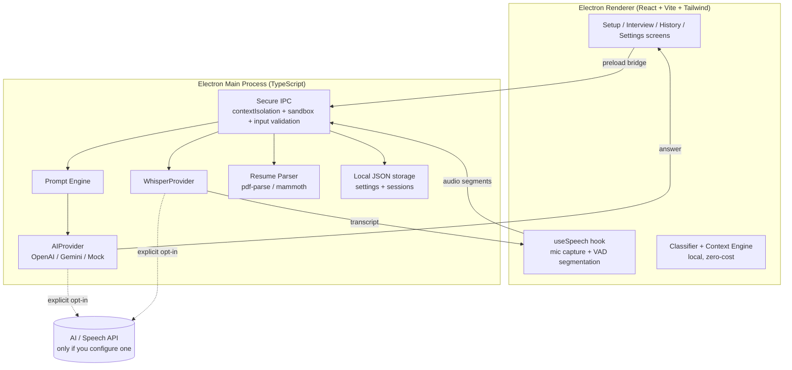

# AI Interview Assistant

A polished, **local-first** desktop app that helps you formulate concise, truthful, speakable answers during interviews - powered by your own AI API key.

**Personal use, free forever.** No accounts, no subscriptions, no cloud backend, no analytics, no tracking. Everything runs on your Windows machine; the only network traffic is to the AI/speech provider *you* explicitly configure (and none at all in Mock mode).

---

## Features

- 🎤 **Speech-to-text pipeline** - microphone → local voice-activity segmentation → transcription → question detection → answer. Partial fragments are never sent to the AI.
- ⌨️ **Manual input fallback** - always available if speech fails.
- 🧠 **Question classification** - INTRODUCTION / HR / BEHAVIORAL / TECHNICAL / CODING / SQL / PROJECT / RESUME / SYSTEM_DESIGN / FOLLOW_UP / GENERAL, done locally with zero API cost.
- 📄 **Resume grounding engine** - parses PDF/DOCX/TXT into structured data, selects the sections relevant to each question, and instructs the AI to **never invent** companies, projects, certifications or experience.
- 📋 **Job description parser** - title, required/preferred skills, responsibilities, technologies, experience, keywords.
- 🔁 **Context engine** - keeps a compact window of recent Q&A so follow-up questions ("What was the biggest challenge?") work, without resending the whole interview.
- 🤖 **Replaceable AI providers** - OpenAI, Google Gemini, or a fully offline Mock provider.
- 🗣️ **Replaceable speech providers** - Whisper API, browser speech recognition, or Mock.
- 💬 **Modes** - HR (human, no buzzwords), Behavioral (STAR internally), Technical, Coding (Approach/Code/Complexity), SQL (Query + explanation), System Design.
- 🪟 **Floating window** - frameless, draggable, resizable, always-on-top pin, adjustable opacity, compact/expanded modes. It behaves as a *normal* desktop app - fully visible in Task Manager, no evasion of system monitoring of any kind.
- ⚡ **Global shortcuts** (customizable) + prominent **STOP** control (`Esc`) that kills the mic, cancels pending AI requests and clears audio buffers.
- 🗂️ **Session history** - local JSON files; view, delete, export (Markdown/JSON).
- 🌐 **Languages** - English, Hindi, Hinglish. Answer lengths: Very Short → Detailed.

## Architecture



**Flow:** Load resume → paste JD → configure interview → start → mic captures question → speech-to-text → question classification → resume/JD/context retrieval → AI answer → displayed in the workspace → follow-ups stay context-aware.

## Tech Stack

| Layer | Tech |
|---|---|
| Desktop | Electron 31, TypeScript |
| Frontend | React 18, Vite 5, Tailwind CSS 3, shadcn-style components, lucide icons |
| Main process | Node.js/TS via esbuild bundle, secure IPC (no extra backend server) |
| AI | Provider abstraction: `OpenAIProvider` · `GeminiProvider` · `MockProvider` |
| Speech | Provider abstraction: `WhisperProvider` · `BrowserSpeechProvider` · `MockSpeechProvider` |
| Parsing | pdf-parse, mammoth |
| Storage | Local JSON files (no database required) |
| Tests | Vitest (61 tests) |

## Installation

**Option A - download a build:** grab the Windows installer or portable exe from
[Releases](https://github.com/Anubhav-01/ai-interview-assistant/releases/latest).

**Option B - run from source:**

```bat
git clone https://github.com/Anubhav-01/ai-interview-assistant.git
cd ai-interview-assistant
start.bat
```

`start.bat` installs dependencies, builds, and launches. Requires [Node.js LTS](https://nodejs.org).

Manual commands:

```bash
npm install
npm run dev      # development (Vite HMR + Electron)
npm start        # build + run production bundle
npm test         # run the test suite
npm run dist     # build a Windows installer + portable exe (release/)
```

## Configuration & API Key Setup

Two equivalent options (the in-app value wins):

1. **In-app:** Settings → AI Provider → paste key → Save.
2. **.env file:** `copy .env.example .env`, then edit:

```env
AI_PROVIDER=openai        # openai | gemini | mock
OPENAI_API_KEY=sk-...
OPENAI_MODEL=gpt-4o-mini
GEMINI_API_KEY=
GEMINI_MODEL=gemini-1.5-flash
SPEECH_PROVIDER=whisper   # whisper | browser | mock
```

`.env` is git-ignored - **keys are never committed and never hardcoded**. Each person who clones the project uses their own key.

### Mock mode

`AI_PROVIDER=mock` (the default) makes the whole app work **without any API key or internet** - ideal for UI testing, demos and development without burning credits.

## Using the Assistant

See **[docs/SETUP.md](docs/SETUP.md)** for the friend-friendly walkthrough: setup screen, speech setup, shortcuts, and where local data lives.

## Speech Setup

- **Whisper** (recommended): needs an OpenAI key. Audio is recorded locally; only finished phrases (detected by local silence analysis) are sent for transcription.
- **Browser**: uses the Web Speech API when the Electron build supports it; otherwise the app shows a clear message and manual input keeps working.
- **Mock**: cycles through sample questions - no mic needed.

Microphone permission errors are reported with actionable messages (Windows privacy settings path included).

## Troubleshooting

| Problem | Fix |
|---|---|
| "No OpenAI API key configured" | Settings → AI Provider → add key → Save (or `.env`). |
| "API key was rejected" | Re-copy the key; check billing/quota on the provider dashboard. |
| "Rate limit reached" | Wait a moment; consider a lighter model (e.g. `gpt-4o-mini`). |
| Mic not working | Windows Settings → Privacy → Microphone → allow apps. Check default input device. |
| Browser speech unavailable | Expected in some Electron builds - switch to Whisper or Mock. |
| Scanned/image PDF fails | Export a text-based PDF, use DOCX/TXT, or paste resume text. |
| Nothing happens on shortcuts | Another app may own that combo - change it in Settings → Shortcuts. |
| App feels slow to answer | Use a faster model and "Short" answers; context is already kept compact. |

The app never crashes on provider errors - every failure surfaces as a readable message in the UI.

## Privacy

- Resume, job description, settings, API keys and session history: **stored locally only** (`data/` in dev, `%APPDATA%/AI Interview Assistant/data/` when installed).
- **No** analytics, telemetry, tracking, ads, accounts or remote database.
- External communication happens **only** with the AI/speech provider you configure, and the UI clearly labels when an external API is in use.
- Mock mode is 100% offline.

## Security

- `contextIsolation: true`, `nodeIntegration: false`, `sandbox: true`.
- The renderer gets a **minimal preload bridge** - no direct Node.js access.
- Every IPC handler validates and sanitizes its inputs.
- Strict CSP in production; external links open in the system browser only.
- Single-instance app; all processes exit when the window closes - no background services, no autostart, no hidden persistence.
- The app is a normal desktop window, fully visible in Task Manager. It does **not** attempt to hide from or interfere with any OS monitoring.

## Project Structure

```
ai-interview-assistant/
├── electron/            # main process
│   ├── main.ts          # window, CSP, shortcuts, lifecycle
│   ├── preload.ts       # secure bridge (the ONLY renderer↔main surface)
│   └── ipc/             # validated IPC handlers (ai, speech, resume, sessions, settings, window)
├── src/                 # React renderer
│   ├── screens/         # Setup, Interview, History, Settings
│   ├── components/      # TitleBar, Sidebar, shadcn-style ui/
│   ├── hooks/useSpeech.ts  # mic capture + VAD + provider switching
│   └── lib/store.tsx    # app state
├── core/                # pure, testable packages (shared by both processes)
│   ├── ai/              # AIProvider + OpenAI/Gemini/Mock
│   ├── speech/          # SpeechProvider contracts + Whisper client
│   ├── resume-parser/   # text → structured ResumeData
│   ├── jd-parser/       # text → structured JobData
│   ├── prompt-engine/   # question-type-aware prompt building
│   ├── context-engine/  # conversation window + resume grounding
│   ├── classifier/      # local question classification
│   └── shared/          # types
├── tests/               # vitest suites
├── docs/SETUP.md
├── scripts/             # dev runner + esbuild main-process build
├── web/                 # static landing/download page (hosted on Railway)
├── .env.example
└── start.bat
```

*(The original brief suggested an `apps/packages` monorepo; a single package with a pure `core/` layer is technically simpler here - same separation, no workspace overhead.)*

## Testing

```bash
npm test          # 61 unit tests: parsers, prompt engine, context engine, classifier, AI providers
npm run typecheck # strict TS across renderer + main + core
```

An automated smoke test also verifies the packaged app end-to-end (renderer boot, IPC bridge, mock AI generation, session save/list/delete, clean exit):

```bash
set AIA_SMOKE_TEST=1 && npx electron .
```

## Building the Windows Version

```bash
npm run dist
```

Produces an NSIS installer and a portable exe in `release/`. Share either with friends - they only need to enter their own API key in Settings.

## License

MIT - personal use. Use responsibly and honestly.
